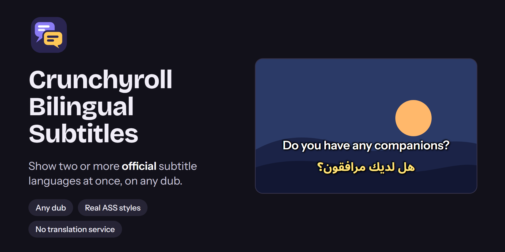
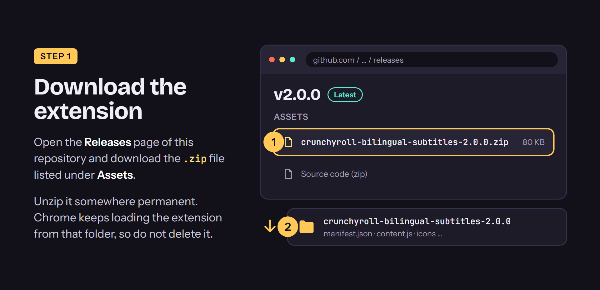
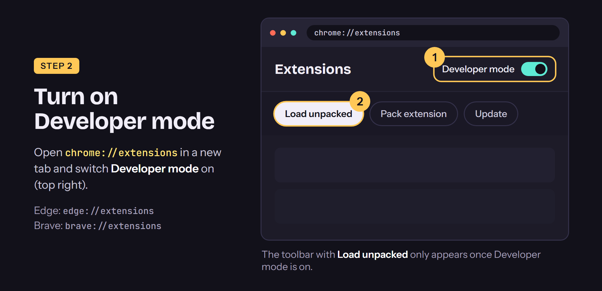
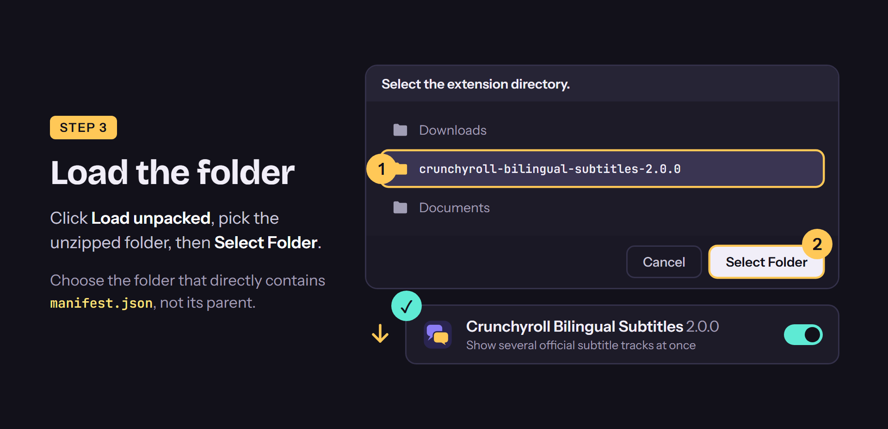
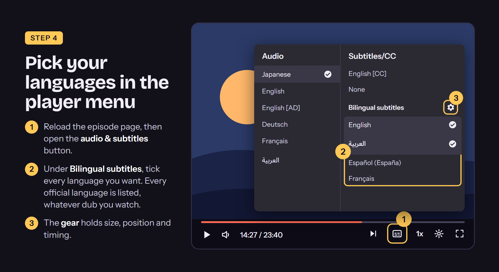
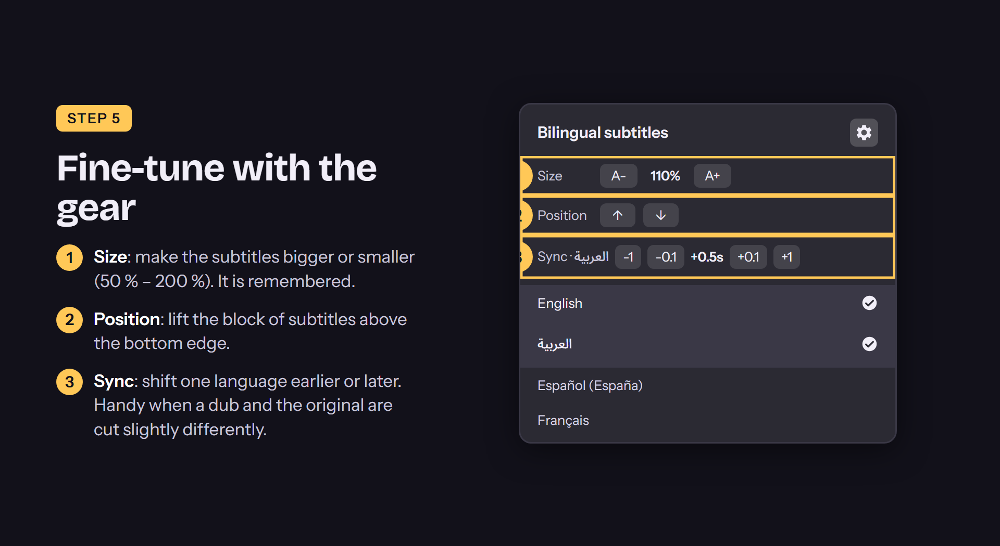
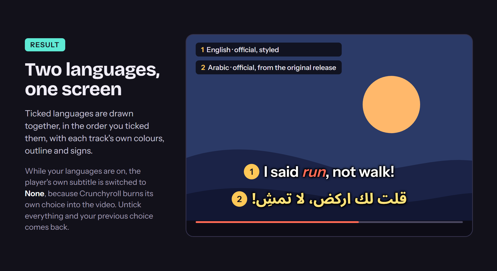

<p align="center">
  
</p>

# Crunchyroll Bilingual Subtitles

A browser extension that shows **two or more official Crunchyroll subtitle languages at the same time**, whichever dub you are watching. It works with Crunchyroll's current web player and adds its options to the player's own **Subtitles/CC** menu, so there is nothing new to learn.

## Features

- **Several languages at once.** Tick as many official subtitle tracks as you like; they are stacked in the order you ticked them.
- **Works with any dub.** An English dub normally only offers English. This extension also lists every language that exists on the original release, so you can watch the English dub with Arabic, Spanish, French… underneath.
- **Real ASS styling.** Colours, italics, outlines, shadows, margins, top-of-screen lines and positioned on-screen sign translations are drawn the way the subtitle file asks for, not as plain text.
- **Right-to-left friendly.** Right-to-left languages such as Arabic are laid out correctly.
- **Per-language controls.** Font size, vertical position and timing (±0.1 s / ±1 s) from a small gear in the menu. Settings are remembered.
- **No translation service.** Only the official subtitle files that Crunchyroll already serves to your player are used. Nothing is sent to Google or anyone else.

## Installation

The extension is not on the Chrome Web Store, so you install it from this repository as an *unpacked extension*. It takes about a minute and works in **Chrome 111+**, **Edge**, **Brave** and other Chromium browsers.

### 1 · Download

Open the [**Releases**](../../releases) page, download the `.zip` under **Assets** and unzip it somewhere permanent. The browser keeps loading the extension from that folder, so do not delete it.



### 2 · Turn on Developer mode

Open `chrome://extensions` (Edge: `edge://extensions`, Brave: `brave://extensions`) and switch **Developer mode** on in the top-right corner.



### 3 · Load the folder

Click **Load unpacked**, choose the unzipped folder that directly contains `manifest.json`, then **Select Folder**. The extension card appears with its switch on.



### Updating and removing

- **Update:** download the new release, replace the old folder's contents with the new files, then press the circular **reload** button on the extension's card and reload your Crunchyroll tab.
- **Remove:** click **Remove** on the extension's card.

### From source

```bash
git clone <this repository>
```

Then follow steps 2 and 3 above and choose the `extension/` folder of the clone.

## Usage

Open any episode and wait for the video to start.

### 4 · Pick your languages

1. Open the player's **audio & subtitles** button.
2. Under **Bilingual subtitles** (at the end of the Subtitles/CC list) tick every language you want. Every official language is listed, whatever dub you are watching.
3. The **gear** next to the heading holds size, position and timing.



### 5 · Fine-tune with the gear



- **Size** – 50 % to 200 %.
- **Position** – lifts the block of subtitles above the bottom edge.
- **Sync** – shifts one language earlier or later. Useful when a dub and the original release are cut slightly differently, or when an episode has a different intro length.

### Result



## Good to know

- **Your own subtitle choice is switched to "None" while this extension's languages are on.** When you pick a language in Crunchyroll's own menu, the service streams a video with that subtitle *burned into the picture*. It cannot be hidden, so it would show twice. Untick everything and your previous choice is restored. Closed captions (`[CC]`) are not affected.
- **Other languages come from the original release.** To list them, the extension briefly asks Crunchyroll for the original version of the episode (using the same session your browser already has) and then releases that extra playback session again. On plans with a single simultaneous stream this request can be refused; the menu then shows a message. Switching the audio to Japanese once makes the languages appear.
- **Timing can differ between a dub and the original.** Use *Sync* in the gear to correct it; it is remembered per episode and language.
- **Not every ASS effect is reproduced.** Animations, clipping, karaoke and vector drawings are skipped. Static styling and positioned text are supported.
- **The site can change.** The extension reads Crunchyroll's page structure. If the **Bilingual subtitles** section stops appearing after a site update, please [open an issue](../../issues).

## Privacy and permissions

- The only site it runs on is `crunchyroll.com`.
- It makes requests only to Crunchyroll and its own content-delivery network: the episode's playback information, the subtitle files, and the release of its extra playback session. No analytics, no third-party servers.
- Crunchyroll's session header is read from the page's own requests, kept **in memory only**, and sent only back to `crunchyroll.com`. It is never stored or logged.
- Your settings (ticked languages, size, position, timing) are stored in the page's `localStorage` on your computer.
- The `tabs` permission is used for one purpose: choosing the coloured or grey toolbar icon from the tab's address.

## How it works

1. Content scripts run in the page's own context and wrap `fetch` / `XMLHttpRequest` to read the player's playback JSON (`/playback/v3/<id>/web/<device>/play`), which lists the available subtitle files and every dub of the episode.
2. For languages that only exist on the original release, the original's playback JSON is requested once per episode.
3. Subtitle files (ASS or WebVTT) are parsed into styled cues and drawn into an overlay laid over the video picture, kept below the player controls.
4. The options are cloned from the player's own menu items and appended to its Subtitles/CC list.

## Development

There is no build step.

```text
extension/
  manifest.json   Manifest V3, content scripts run in the page world
  parsers.js      ASS and WebVTT parsers
  renderer.js     draws styled cues over the video picture
  content.js      network hooks, track handling, menu integration
  background.js   colours the toolbar icon on Crunchyroll tabs
docs/
  images/         pictures used in this README
  design/         icon sources (SVG)
```

- **Run it:** load `extension/` as described in *Installation*; after each change press **reload** on the extension card and reload the Crunchyroll tab.
- **Syntax check:** `node --check extension/content.js` (same for the other scripts).
- **Release zip:** copy `extension/` to a folder named `crunchyroll-bilingual-subtitles-<version>` and zip that folder with any tool, for example `tar -a -c -f crunchyroll-bilingual-subtitles-<version>.zip crunchyroll-bilingual-subtitles-<version>`.
- **Icons:** the PNGs in `extension/icons/` are rendered from the SVGs in `docs/design/` (the `-small` variants without the inner lines are used for 16 and 32 px).

## Disclaimer

This is an independent project. It is **not affiliated with, endorsed by or sponsored by Crunchyroll**; "Crunchyroll" is a trademark of its owner. You need your own Crunchyroll account. The extension does not download or save videos and does not bypass any protection: it only displays subtitle text that the site already delivers to your player.

It was inspired by an earlier extension of the same name that stopped working with Crunchyroll's redesigned player. This is a new, independent implementation.

## License

[MIT](LICENSE)
